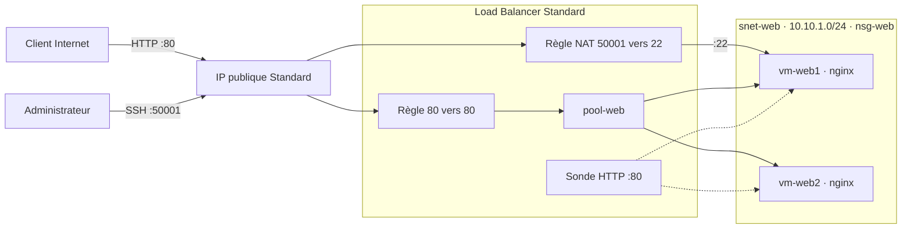
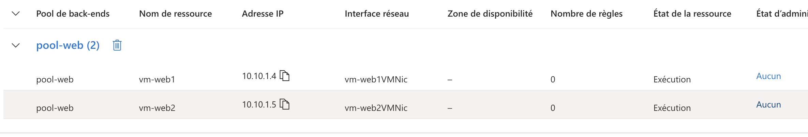
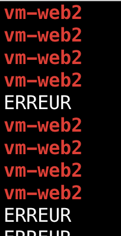
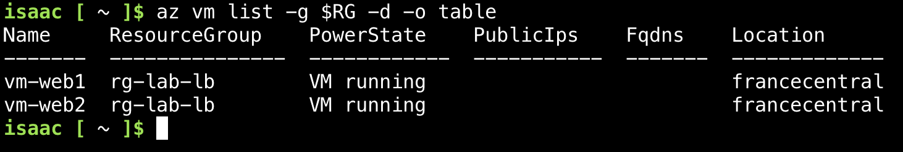

# ⚖️ az104-load-balancer

Lab pratique Azure réalisé en préparation de la certification **AZ-104 (Microsoft Azure Administrator Associate)** : un **Load Balancer Standard public** devant deux serveurs web, déployé entièrement en Azure CLI depuis Cloud Shell.

## 🎯 Objectif

Démontrer la **haute disponibilité en couche 4** (TCP) : une seule IP publique, le trafic réparti entre deux VM, et une bascule automatique quand l'une d'elles tombe.

## 🏗 Architecture



| Ressource | Configuration |
|---|---|
| Groupe de ressources | `rg-lab-lb`, France Central |
| Réseau | VNet `vnet-lab-lb` (10.10.0.0/16), sous-réseau `snet-web` (10.10.1.0/24) |
| Sécurité | NSG `nsg-web` sur le sous-réseau : port 80 depuis `Internet` et `AzureLoadBalancer`, port 22 pour l'administrateur |
| Calcul | `vm-web1` (10.10.1.4) et `vm-web2` (10.10.1.5), Ubuntu 24.04, Standard_B1s, **sans IP publique**, nginx par cloud-init |
| IP publique | Standard, statique (4.233.88.61 pendant le lab), seul point d'entrée |
| Load Balancer | `lb-web`, SKU Standard : frontal `fe-web`, pool `pool-web`, sonde `probe-http` (HTTP :80, toutes les 15 s), règle `rule-http` (80 vers 80), règle NAT `nat-ssh-vm1` (50001 vers 22 sur `vm-web1`) |



## 🧠 Choix d'architecture

- **SKU Standard** : le Basic est retiré depuis septembre 2025. Le Standard est fermé par défaut, rien n'entre sans NSG.
- **VM sans IP publique** : la seule surface exposée est l'IP du Load Balancer.
- **NSG sur le sous-réseau** : une seule politique pour toutes les VM web, présentes et futures.
- **Port 80 ouvert depuis `Internet`** : le Load Balancer Standard conserve l'IP du client, la VM voit donc une requête venant d'Internet.
- **Sonde HTTP plutôt que TCP** : elle vérifie que nginx répond, pas seulement que le port est ouvert.
- **Règle NAT pour le SSH** : elle permet d'administrer une VM précise sans IP publique. En production, Azure Bastion serait préférable.

## 📁 Structure du dépôt

```
az104-load-balancer/
├── README.md
├── scripts/
│   ├── deploy.sh               # Déploiement complet en Azure CLI
│   ├── cloud-init-web.yaml     # Installation de nginx au premier démarrage
│   └── cleanup.sh              # Suppression du groupe de ressources
└── docs/screenshots/           # Captures des étapes
```

## 🚀 Déploiement

```bash
git clone https://github.com/Isaac1h/az104-load-balancer.git
cd az104-load-balancer
SSH_SOURCE_IP=<ton-ip-publique> ./scripts/deploy.sh
```

Le script crée dans l'ordre : groupe de ressources, réseau et NSG, IP publique, Load Balancer (frontal, pool, sonde, règles), puis les deux VM. Toutes les valeurs se surchargent par variable d'environnement (voir l'en-tête de `deploy.sh`).

Par rapport au lab réalisé à la main, le script ajoute une **règle sortante** : les VM n'ont pas d'IP publique et doivent quand même sortir sur Internet pour installer nginx.

## 🧪 Tests et résultats

**Répartition.** Le Load Balancer choisit la VM par un hachage sur cinq éléments (IP et port source, IP et port destination, protocole). À chaque nouvelle connexion, le port source change, donc le hachage change, donc la VM peut changer :

```bash
for i in $(seq 1 10); do curl -s http://<IP_LB> | grep -o 'vm-web[0-9]'; done
```

Résultat : les réponses alternent entre `vm-web1` et `vm-web2`. Un navigateur peut rester sur la même VM, car il réutilise sa connexion (keep-alive).

**Accès administrateur ciblé.** `ssh -p 50001 azureuser@<IP_LB>` arrive systématiquement sur `vm-web1`, jamais sur `vm-web2` : la règle NAT entrante cible bien une seule VM.

**Haute disponibilité.** Une boucle interroge le site chaque seconde, puis on arrête `vm-web1` avec `az vm stop -g rg-lab-lb -n vm-web1`.

```bash
while true; do curl -s -m 2 http://<IP_LB> | grep -o 'vm-web[0-9]' || echo ERREUR; sleep 1; done
```

Résultat : alternance normale, puis quelques `ERREUR` le temps que la sonde constate la panne (elle interroge toutes les 15 secondes), puis bascule complète et durable sur `vm-web2`. Le service est resté disponible.





## ⚠️ Incidents rencontrés et diagnostic

Trois incidents, tous résolus sans accès direct aux machines :

| Problème | Cause | Solution |
|---|---|---|
| **Port 80 bloqué malgré `nsg-web`** | `az vm create` attache un NSG implicite à chaque carte réseau, avec seulement `default-allow-ssh`. Le trafic doit traverser **les deux** NSG, et celui de la carte rejetait le port 80. | Détacher les NSG implicites pour garder un seul point de filtrage : `az network nic update -g rg-lab-lb -n vm-web1VMNic --remove networkSecurityGroup` |
| **VM déclarées non intègres par la sonde** | Le cloud-init passé par `--custom-data` ne s'était pas exécuté. Diagnostic avec `az vm run-command invoke`, sans SSH : nginx `inactive`, rien sur `localhost`, pas d'`index.html`. | Installer nginx directement par `az vm run-command invoke --command-id RunShellScript` |
| **Clé SSH perdue en cours de session** | Cloud Shell est éphémère : la clé privée générée au départ avait disparu. | Nouvelle paire de clés, puis clé publique ajoutée à `~azureuser/.ssh/authorized_keys` par `az vm run-command invoke` |

Le script `deploy.sh` évite le premier incident : il crée lui-même les cartes réseau, sans NSG.

## 📚 Ce que j'ai appris

- **Le Load Balancer peut être parfait et le service indisponible.** Ici, la sonde faisait son travail en déclarant les VM non intègres, puisqu'aucune application n'écoutait sur le port 80.
- **Le diagnostic se fait du bas vers le haut.** D'abord l'application en local (`run-command`, puis `curl localhost`), ensuite les NSG aux deux niveaux, et seulement après la configuration du Load Balancer.
- **Cloud Shell n'est pas un poste de travail.** Les clés et fichiers importants doivent vivre dans le stockage persistant (`~/clouddrive`) ou ailleurs.
- **La répartition se fait par connexion, pas par requête.** C'est un hachage sur 5 éléments, pas un tourniquet. Pour router selon l'URL, il faut de la couche 7 (Application Gateway).
- **Le NSG filtre après la traduction NAT.** Pour la règle NAT 50001 vers 22, la règle NSG doit porter sur le port 22.
- **La bascule n'est pas instantanée.** Entre la panne et sa détection, quelques requêtes échouent : l'intervalle de la sonde fixe ce délai.
- **Limites du lab :** les deux VM sont dans la même zone. En production, on viserait des zones de disponibilité, Azure Bastion pour l'administration et un Scale Set pour l'élasticité.

## 🧹 Nettoyage

```bash
./scripts/cleanup.sh   # supprime rg-lab-lb et tout son contenu
```

---
**Auteur :** Isaac Hassani · Réalisé sur un abonnement *Azure for Students*, parcours AZ-900, puis **AZ-104**.
